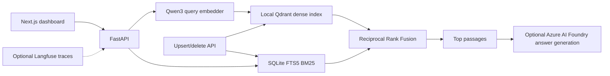

# Adrosonic Vector Retrieval for RAG

A local-first retrieval system and hackathon demo for grounded question answering. The backend combines Qwen dense embeddings, Local Qdrant, SQLite FTS5 BM25, and Reciprocal Rank Fusion (RRF). A Next.js dashboard shows service state, live retrieval, metadata filtering, index updates, evaluation provenance, and benchmark results.

## Current result provenance

| View | Source | What it means |
| --- | --- | --- |
| Actual Results | `reports/phase2/evaluation/ragas_matched_corpus.json` | Completed 10-query matched-corpus retrieval and RAGAS evaluation; the queries are synthetic and are not official MS MARCO queries. |
| 100-Query Demo | `reports/demo/benchmark_100_simulated.json` | Deterministic simulated chart data; no 100-query retrieval run is performed to create or display it. |

The frontend keeps these views in separate tabs. Demo values are marked **DEMO / SIMULATED** and never enter the production retrieval path or actual evaluation/benchmark reports.

## Architecture



## Tech stack

- Python, FastAPI, Pydantic, Loguru
- Qwen3-Embedding-0.6B, 1,024-dimensional dense vectors
- Qdrant Local at `storage/qdrant`, collection `passages`
- SQLite FTS5 BM25 at `storage/sparse.sqlite3`
- Dense and sparse candidate retrieval with RRF fusion
- Next.js App Router, React, TypeScript, Framer Motion, Recharts, and Lucide
- RAGAS 0.2.15 for Context Precision and Context Recall
- Optional Azure AI Foundry for grounded answer generation and the saved RAGAS run
- Optional Langfuse tracing

## Installation

Use Python 3.12 on Windows and a supported Node.js release for Next.js 16. Qwen model startup and Local Qdrant need substantial memory and Windows commit/pagefile capacity; the 100-query visualization does not reduce those requirements for live retrieval.

```powershell
py -3.12 -m venv venv
.\venv\Scripts\Activate.ps1
python -m pip install --upgrade pip
pip install -r requirements.txt
if (!(Test-Path .env)) { Copy-Item .env.example .env }

cd frontend
npm install
if (!(Test-Path .env.local)) { Copy-Item .env.local.example .env.local }
```

For NVIDIA inference, install a CUDA-enabled PyTorch wheel compatible with the installed Windows/Python/CUDA versions, then verify `torch.cuda.is_available()`. If CUDA is unavailable, the backend may fall back to CPU, which needs more system RAM. Do not start corpus ingestion as part of the dashboard demo.

## Configuration

Keep credentials in the ignored root `.env` and frontend proxy URLs in `frontend/.env.local`. Never commit or print secret values.

The principal local retrieval settings are:

```dotenv
EMBEDDING_MODEL=Qwen/Qwen3-Embedding-0.6B
QDRANT_PATH=storage/qdrant
QDRANT_COLLECTION=passages
BM25_INDEX_PATH=storage/sparse.sqlite3
TOP_K=5
RRF_K=60
DENSE_CANDIDATE_K=50
SPARSE_CANDIDATE_K=50
```

For Azure grounded generation, configure `AZURE_OPENAI_API_KEY`, `AZURE_OPENAI_ENDPOINT`, and `AZURE_OPENAI_DEPLOYMENT`. For optional tracing, configure `LANGFUSE_ENABLED`, `LANGFUSE_PUBLIC_KEY`, `LANGFUSE_SECRET_KEY`, and `LANGFUSE_HOST`. These values are read by the backend and are not sent to browser code. See [docs/observability.md](docs/observability.md) for Langfuse behavior and limitations.

## Run the application

Start the backend from the repository root:

```powershell
uvicorn app.api:app --host 127.0.0.1 --port 8000
```

In a second terminal, start the dashboard:

```powershell
cd frontend
npm run dev
```

Open `http://127.0.0.1:3000`. The frontend uses a same-origin Next.js proxy to the FastAPI service (`BACKEND_API_URL`, default `http://127.0.0.1:8000`). API docs are at `http://127.0.0.1:8000/docs`; `/health` and `/status` report backend/index readiness. A dashboard/API connection error does not mean saved report files are missing.

## Retrieval

### Dense retrieval

Qwen embeds the query, then Local Qdrant searches the configured collection using cosine similarity. Search returns passages and ranking scores; scores are not probabilities.

### BM25

The SQLite FTS5 index performs sparse term-based retrieval. Its persisted rows are updated with the live update API. BM25 is also reported as a separate mode in the saved matched-corpus evaluation.

### Hybrid retrieval and RRF

Hybrid mode requests the configured dense and sparse candidate lists and combines their ranks with Reciprocal Rank Fusion. RRF uses `RRF_K` (currently 60); dense cosine scores and BM25 scores are not added together. `TOP_K` controls the number of final passages returned.

### Metadata filtering

The current HTTP API accepts an exact non-negative `source_id` filter. It applies that filter to both candidate retrievers before fusion and does not fall back to an unfiltered search if the filter has no matches:

```json
{
  "query": "why do nails get rusty",
  "mode": "hybrid",
  "top_k": 5,
  "filter": { "source_id": 19699 }
}
```

See [docs/metadata_filtering.md](docs/metadata_filtering.md) for payload provenance and the Local Qdrant payload-index limitation.

## API

The primary endpoints are:

| Method | Route | Purpose |
| --- | --- | --- |
| `GET` | `/health` | Embedding, Qdrant, BM25, and configured Azure readiness |
| `GET` | `/status` | Indexed counts, collection, model, and mutation synchronization state |
| `POST` | `/search` | Dense or hybrid retrieval; optional source filter and grounded answer generation |
| `POST` | `/upsert` | Add or replace one passage in both indexes |
| `DELETE` | `/passages/{passage_id}` | Delete exactly one passage from both indexes |

Example search:

```powershell
$body = @{ query = "how does photosynthesis work"; mode = "hybrid"; top_k = 5; filter = @{ source_id = 19699 } } | ConvertTo-Json -Compress
Invoke-RestMethod 'http://127.0.0.1:8000/search' -Method Post -ContentType 'application/json' -Body $body
```

`mode` is `dense` or `hybrid`. Set `generate_answer` to `true` to request an optional Azure grounded answer after retrieval. See [docs/live_updates.md](docs/live_updates.md) before changing indexed data.

## Live index updates

Each upsert embeds a single passage and synchronizes that ID in Local Qdrant and SQLite FTS5. A write-ahead mutation journal records the pending operation and supports recovery after partial failures. Deletes target one explicit passage ID; there is no bulk-delete endpoint. The [Live Updates guide](docs/live_updates.md) documents the flow and safe disposable demo procedure.

## Langfuse and logs

Loguru writes structured local events. Langfuse is optional and failure-isolated; when enabled it receives retrieval/generation observations and selected query/context details. The dashboard reports configuration separately from connectivity and does not claim traces are available unless an API exposes them. See [docs/observability.md](docs/observability.md).

## Evaluation

The saved actual evaluation contains 10 matched-corpus queries, evaluated across Dense, BM25, and Hybrid/RRF. RAGAS 0.2.15 Context Precision and Context Recall were scored with the configured Azure AI Foundry `gpt-4.1` judge. Queries were generated from the active indexed passage text, and references were matched to the same passages; this is a matched-corpus pilot, **not official MS MARCO evaluation**.

| Mode | Hit@1 | Hit@5 | Hit@10 | MRR | Context Precision | Context Recall |
| --- | ---: | ---: | ---: | ---: | ---: | ---: |
| Dense | 0.70 | 1.00 | 1.00 | 0.833 | 0.9539 | 1.0000 |
| BM25 | 0.40 | 0.80 | 0.90 | 0.582 | 0.6733 | 0.8400 |
| Hybrid/RRF | 0.70 | 0.90 | 1.00 | 0.814 | 0.9543 | 0.9400 |

The complete provenance, per-query scores, and errors are preserved in [reports/phase2/evaluation/ragas_matched_corpus.json](reports/phase2/evaluation/ragas_matched_corpus.json). See [docs/evaluation.md](docs/evaluation.md) for interpretation and status definitions.

## Benchmarking and demo

The `/benchmark` page has two separate views:

1. **Actual Results** shows the measured 10-query matched-corpus retrieval and RAGAS metrics above.
2. **100-Query Demo** shows deterministic simulated latency distributions, per-query charts, and mode comparisons for 100 query IDs across three retrieval modes. Its badge and notice say **DEMO / SIMULATED**; the displayed latency values are not measurements.

Regenerate only the demo fixture (this script makes no model, API, Qdrant, BM25, or retrieval calls):

```powershell
.\venv\Scripts\python.exe scripts\generate_demo_benchmark.py
```

The fixture is `reports/demo/benchmark_100_simulated.json`. It is separate from `reports/phase2/benchmarks/benchmark_summary.json`, raw benchmark logs, and all RAGAS results. To perform a future real run, use `python -m app.benchmark --queries 100` only when you intend to execute retrieval on the indexed corpus; it is not needed to view the demo.

See [docs/benchmark.md](docs/benchmark.md), [docs/demo.md](docs/demo.md), and [reports/final_benchmark_report.md](reports/final_benchmark_report.md) for exact provenance and limitations.

## Tests and frontend checks

Python tests use temporary stores and a deterministic test embedder. For frontend code:

```powershell
cd frontend
npm run lint
npm run typecheck
npm run build
```

Do not use the simulated fixture to set production latency targets, estimate hardware capacity, or describe retrieval as executed.
