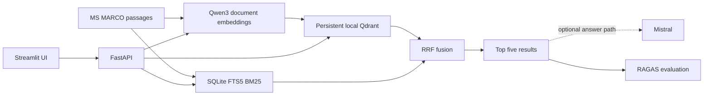

# Adrosonic Phase 2 — Final Evaluation Report

**Evaluation date:** 2026-10-03  
**Project:** Vector Database Design for Large-Scale Precision Retrieval in RAG Systems  
**Execution status:** Blocked before corpus ingestion; only offline/unit-level checks were measurable.

## 1. Executive summary

The ingestion command was actually run with `--limit 100000`, but Hugging Face access failed with a connection-refused error before the dataset yielded a row. The installed environment also lacks `qdrant-client` and RAGAS, and the Qwen checkpoint is not cached. The configured Qdrant and SQLite BM25 stores are absent. Therefore the verified corpus size is **0**; no real retrieval queries, Mistral judge calls, RAGAS scores, or retrieval latency samples were produced.

This is a blocked execution report, not a successful 100k evaluation. No missing metric is represented as zero or inferred. The project was minimally updated with an official MS MARCO Parquet loading route and an independent corpus validation command. Offline tests passed for the components available in this environment. Detailed cause and follow-up evidence are in [ingestion_diagnostics.md](ingestion_diagnostics.md).

## 2. Problem statement and Phase 2 objectives

Phase 2 is intended to index 100,000 original MS MARCO passages with Qwen3-Embedding-0.6B in persistent local Qdrant, maintain the same corpus in SQLite FTS5 BM25, fuse dense and sparse results with RRF, compare retrieval on valid MS MARCO judgments, evaluate Context Precision/Recall with RAGAS and an explicitly configured Mistral judge, and benchmark 100 dense plus 100 hybrid requests. This run could not progress past source acquisition.

## 3. System architecture



The architecture above describes the inspected implementation, not a live end-to-end run. This run did not instantiate Qdrant or Qwen.

## 4. Actual hardware and software environment

| Component | Observed value |
|---|---|
| OS | Windows 11, build 10.0.26300 |
| Python | 3.13.15 |
| CPU | 20 logical CPUs |
| RAM | 7.7 GB |
| Accelerator | CPU only; PyTorch reports no CUDA device |
| Free disk at audit | 213.73 GB on C: |
| PyTorch / Transformers / Datasets | 2.14.0 / 5.8.1 / 5.0.0 |
| FastAPI / Pydantic | 0.119.0 / 2.11.7 |
| Streamlit / pytest / httpx / psutil | 1.48.0 / 8.4.2 / 0.28.1 / 7.0.0 |
| qdrant-client / RAGAS | Not installed |
| Qwen model cache | Absent |

## 5. MS MARCO dataset source and corpus statistics

Configured dataset: `microsoft/ms_marco`, config `v1.1`; `train` is the indexing split and `validation` is the intended evaluation split. The loader uses the repository's v1.1 Parquet route to avoid the legacy dataset-script pathway under Datasets 5.x. Dataset version/commit was not pinned; the loader references `main`.

| Corpus measure | Verified result |
|---|---:|
| Requested limit | 100,000 |
| Source records yielded | 0 |
| Passage records read | 0 |
| Unique passage IDs indexed | 0 |
| Nonempty passages indexed | 0 |
| Duplicates / malformed passages observed | 0 / 0 (iteration never began) |
| Qdrant logical points | Unavailable; store absent and client missing |
| BM25 logical documents | 0; configured SQLite store absent |
| Dense/sparse IDs equal | Not evaluated |

The source request failed with `httpx.ConnectError: [WinError 10061] No connection could be made because the target machine actively refused it`. No data was downloaded or substituted.

## 6. Actual indexing results

`python -m app.ingest --limit 100000` was executed. Ingestion failed while opening the dataset, before constructing the embedder or index. It reported no silent skips: zero rows were yielded and zero passages were processed. No duration, throughput, disk usage attributable to indexing, or index memory was measured.

| Store | Configured location | Actual status/count |
|---|---|---|
| Qdrant | `storage/qdrant`, collection `passages` | Directory/collection absent; count API unavailable |
| SQLite FTS5 BM25 | `storage/sparse.sqlite3` | File absent; 0 documents |
| Update journal | `storage/update_journal.jsonl` | Absent |

## 7. Qwen3 embedding configuration

| Setting | Configured value | Observed execution |
|---|---|---|
| Model | `Qwen/Qwen3-Embedding-0.6B` | Not loaded; cache absent and source acquisition failed first |
| Revision | `main` | Mutable branch, not a pinned commit |
| Device | `auto` | Host is CPU-only; model device selection was not reached |
| Precision | `auto` | No effective dtype measured; loader currently uses the model's default dtype |
| Batch size | 4 | Configured; no batch executed |
| Vector dimension | Model hidden size intended | Not measured |
| Normalization | L2 normalization in source | Not executed |
| Embedding errors | N/A | No embeddings attempted |

The source implementation loads the model once per embedder, uses inference mode, separates query instruction formatting from document encoding, pools the final non-padding token, and normalizes vectors. Those behaviors were inspected in code, not validated against live model outputs.

## 8. Qdrant configuration

Configured local persistent collection is `passages` at `storage/qdrant`, with cosine distance, HNSW `m=16`, `ef_construct=100`, and search `ef_search=64`. The source includes payload indexes for selected metadata. `qdrant-client` could not be installed from the available package index, and the storage directory did not exist. Collection vector size, distance, payload indexes, persistence, and restart behavior were not verified.

## 9. BM25 configuration

The inspected sparse implementation is SQLite FTS5 with `unicode61 remove_diacritics 2`, original text, stable logical IDs, and SQLite `bm25()` ranking. The configured path is `storage/sparse.sqlite3`. A fixture test exercised FTS retrieval, metadata filtering, updates, and deletes. No production database or corpus was created.

## 10. Hybrid RRF methodology

The inspected hybrid path requests up to 50 candidates from each retriever and combines one-based ranks with Reciprocal Rank Fusion using `k=60`; the default output size is five. RRF ordering and tie-breaking passed a unit test. No dense or hybrid retrieval ran against an actual corpus.

## 11. Actual retrieval queries and examples

| Retrieval mode | Valid queries executed | Retrieved passages | Example |
|---|---:|---:|---|
| Dense | 0 | 0 | None available |
| BM25 | 0 | 0 | None available |
| Hybrid RRF | 0 | 0 | None available |

The validation split could not be downloaded, so no valid query, answer, or relevance judgments were available. No fabricated query or relevance label was used. The evaluation and benchmark directories contain status artifacts, not per-query result records.

## 12. Mistral RAGAS evaluation setup

The configured judge model is `mistral-small-latest`; the project has a Mistral integration and a Mistral/RAGAS evaluation path. The environment reports a Mistral key configured, but the key was never displayed or written to artifacts. No Mistral API request was made because free-tier/model allowance was not independently verified (`MISTRAL_FREE_TIER_CONFIRMED=false`). RAGAS is not installed. There were **0** Mistral calls and no RAGAS LLM factory invocation in this run.

## 13. Actual Context Precision and Context Recall

| Retrieval mode | Evaluation queries | Context Precision | Context Recall | Status |
|---|---:|---:|---:|---|
| Dense baseline | 0 | N/A | N/A | Not evaluated |
| Hybrid RRF | 0 | N/A | N/A | Not evaluated |

Targets are Context Precision > 0.75 and Context Recall > 0.70. Neither was tested. Unavailable does not mean zero. No per-query RAGAS rows or evaluation exceptions from metric execution exist.

## 14. Dense versus hybrid comparison

| Measure | Dense | Hybrid RRF |
|---|---:|---:|
| Same valid query set | Not available | Not available |
| Retrieved candidates/results | 0 | 0 |
| Context Precision / Recall | N/A / N/A | N/A / N/A |
| Comparative conclusion | No evidence for a quality comparison | No evidence for a quality comparison |

Recall@5, MRR@5, and nDCG@5 were not computed; the valid qrels/query set was unavailable.

## 15. Supplementary retrieval metrics

No ranking metrics can be computed without actual retrieved IDs and relevance judgments. No values are estimated or fabricated.

## 16. Actual 100-query benchmark results

The request was for 100 consecutive requests in each of dense and hybrid modes. None ran because no corpus or valid query set was available.

| Mode | Requests | Failed | p50 ms | p95 ms | p99 ms | Mean ms | Min ms | Max ms | p95 < 300 ms |
|---|---:|---:|---:|---:|---:|---:|---:|---:|---|
| Dense | 0 | 0 | N/A | N/A | N/A | N/A | N/A | N/A | Unverified |
| Hybrid | 0 | 0 | N/A | N/A | N/A | N/A | N/A | N/A | Unverified |

## 17. Latency breakdown and target status

No latency samples exist. Query embedding, Qdrant, BM25, RRF, serialization, and end-to-end API latencies are all unavailable; Mistral generation latency was not measured. The inspected benchmark currently measures total in-process search time and does not expose all requested stage timings or API network overhead. The p95 target of 300 ms was not tested and is not claimed met.

## 18. Index consistency and persistence validation

No indexes existed, so corpus ID equality, exact Qdrant count, sparse count, nonempty stored texts, sample retrieval, live search, and reopen-after-restart could not be measured. Added `python -m app.validate_corpus` to compare complete Qdrant logical ID payloads against the SQLite ID set, verify expected counts/texts and sample passage retrieval, and attempt live model/vector/search checks. It writes `corpus_validation.json` and fails closed when prerequisites or acceptance checks fail. The current recorded status is blocked.

## 19. Automated test results

| Command/check | Actual result |
|---|---|
| `python -m compileall -q app streamlit_app.py tests` | Passed |
| `python -m pytest tests -p no:cacheprovider -q` | 8 passed, 2 skipped; exit code 0 |
| Skips | Qdrant integration/update/filter/reopen tests; `qdrant-client` unavailable |
| API degraded-index behavior | Search/upsert/delete return 503 after exception handling fix |
| SQLite FTS5 fixture and RRF | Passed |
| Live API results from indexed corpus | Not available; no corpus |

The test evidence is in [test_results.md](test_results.md). After adding the validation script, it is syntax-checked as part of the final compile command; no new tests were added.

## 20. Errors encountered and fixes attempted

1. Datasets 5.x cannot use the legacy dataset-script pathway for this source. The loader now requests the official v1.1 repository Parquet file directly.
2. The Parquet request failed with `WinError 10061` because the host actively refused the Hugging Face connection. This environmental blocker was not bypassed and no substitute data was used.
3. Installing `qdrant-client` failed with “No matching distribution found”; no collection was initialized.
4. The Qwen checkpoint was not locally cached; model download/inference was not reached.
5. Missing-index API mutations previously converted HTTP 503 readiness errors into 500 responses. The handlers now re-raise `HTTPException`; the degraded-mode test passes.

## 21. Limitations and unfulfilled requirements

The mandatory 100,000-passage corpus was not indexed. Qdrant/BM25 parity, retrieval, 20-query RAGAS evaluation, actual Mistral judge usage, the 100-query-per-mode benchmark, p95 latency, supplementary metrics, persistence reopening, and real API retrieval remain incomplete. The active runtime uses Python 3.13.15 and has limited RAM (7.7 GB) with no GPU; the project recommends Python 3.11/3.12 for dependency compatibility. The model revision is not commit-pinned. No claim is made that a configured feature passed a live integration check.

## 22. Reproduction instructions

On a machine where the official Hugging Face dataset/model endpoints and package index are reachable, use Python 3.11 or 3.12 and install the pinned project requirements in a fresh environment. Preserve the existing secret file; never place key values in command output.

```powershell
py -3.12 -m venv .venv
.\.venv\Scripts\Activate.ps1
python -m pip install --upgrade pip
pip install -r requirements.txt
python -m app.ingest --limit 100000
python -m app.validate_corpus
python -m app.prepare_eval --count 20
python -m app.evaluate
python -m app.benchmark --queries 100
python -m pytest tests -p no:cacheprovider -q
```

Proceed to evaluation only after `corpus_validation.json` reports `passed`. Verify that the configured Mistral model and account allowance permit use before setting `MISTRAL_FREE_TIER_CONFIRMED=true`; keep the key out of logs and reports. Launch the services with `uvicorn app.api:app --host 127.0.0.1 --port 8000` and `streamlit run streamlit_app.py` after successful indexing.

## Acceptance checklist

| Requirement | Implemented | Tested here | Measured from real corpus | Status |
|---|---|---|---|---|
| MS MARCO v1.1 Parquet loader | Yes | Loader configuration test | No rows yielded | Blocked by network |
| Exactly 100,000 unique passages indexed | Ingestion path exists | No | 0 verified | Not met |
| Qwen document/query vectors | Source implementation exists | No live model test | No vectors | Not met |
| Persistent Qdrant collection | Source implementation exists | Qdrant integration skipped | No collection | Not met |
| SQLite FTS5 BM25 | Yes | Fixture tests passed | No corpus database | Partial |
| Dense/sparse logical ID validator | Added | Syntax check only; no stores | Cannot run to completion | Blocked |
| 20+ valid dense/hybrid retrieval queries | Pipeline exists | No | 0 | Not met |
| RAGAS Context Precision/Recall with Mistral | Integration path exists | No; RAGAS absent and allowance unverified | No scores, 0 calls | Not met |
| 100 dense + 100 hybrid latency queries | Benchmark script exists | No | 0 | Not met |
| p95 below 300 ms | Target documented | No | N/A | Unverified |
| Automated offline tests | Yes | 8 passed, 2 skipped | As shown above | Partial |
| PDF and reproducibility artifacts | Yes | PDF text/render inspection | Reflect blocked run | Complete for reporting |
