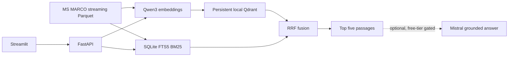

# Adrosonic Phase 2 Technical Evaluation Report

**Evaluation date:** 2026-10-03  
**Project:** Vector Database Design for Large-Scale Precision Retrieval in RAG Systems  
**Report status:** Environment audit and available local validation completed; corpus-scale evaluation blocked by network and dependency availability.

## 1. Executive summary

The existing Phase 2 project was audited and its available local tests were executed. The configured Qdrant and BM25 data stores do not exist, the Qwen model is not cached, the active environment has no `qdrant-client` or RAGAS package, and the host cannot reach Hugging Face. Therefore ingestion did not begin and no real retrieval, RAGAS, or corpus benchmark results are available.

The measured corpus is **0 verified passages**. Context Precision, Context Recall, Recall@5, MRR@5, nDCG@5, and all latency statistics are **unavailable**, not zero. The 300 ms p95 target was not tested. No Mistral requests were made because the account/model free-tier allowance was not verified. No acceptance target is claimed as met.

Work completed: repository and environment audit, one MS MARCO ingestion attempt, a direct validation-split access check, degraded-index API validation, the existing pytest suite, correction of unavailable-index API status codes, and creation of this reproducibility/evaluation package.

## 2. System architecture



The ingestion path reads original MS MARCO passages without chunking, assigns IDs from query ID and passage position, batches document embeddings, and writes to Qdrant and SQLite FTS5. Search embeds the query for Qdrant dense search; hybrid mode also runs SQLite FTS5 BM25 and combines ranks with reciprocal rank fusion (RRF). Qdrant payload filters and equivalent JSON metadata predicates constrain the two paths before ranking. FastAPI exposes health, status, search, upsert, and delete; Streamlit provides search and maintenance forms.

The dense and hybrid implementation exists in source, but this run could not initialize either index. This report distinguishes source inspection and unit-level validation from live retrieval evidence.

## 3. Environment and configuration

| Item | Observed value |
|---|---|
| OS | Windows 11, build 10.0.26300 |
| Python | 3.13.15 |
| CPU | 20 logical CPUs |
| RAM | 7.7 GB |
| CUDA | Unavailable; PyTorch reports no CUDA devices |
| Free disk at audit | 213.73 GB on C: |
| PyTorch | 2.14.0 |
| Transformers | 5.8.1 |
| Datasets | 5.0.0 |
| FastAPI | 0.119.0 |
| Pydantic | 2.11.7 |
| Streamlit | 1.48.0 |
| pytest | 8.4.2 |
| Qdrant client | Not installed |
| RAGAS | Not installed |
| Qwen local cache | Absent |

Configuration snapshot: model `Qwen/Qwen3-Embedding-0.6B`, revision `main`; dataset `microsoft/ms_marco`, config `v1.1`; requested data limit 100,000; embedding batch size 4; Qdrant collection `passages`; HNSW `m=16`, `ef_construct=100`, `ef_search=64`; candidate counts 50 dense and 50 sparse; RRF `k=60`; default top five. The model revision is a mutable `main` reference rather than a commit SHA. The precision setting exists but the current loader does not set a non-default model dtype; effective precision was not measured because the model did not load.

`.env` contains Hugging Face and Mistral credentials. Their values were not printed or written to reports. The Mistral free-tier confirmation flag is false. The package index could not resolve Qdrant distributions. The configured Hugging Face Parquet URL failed with `WinError 10061` (connection actively refused). The Qwen model snapshot is not cached.

## 4. Dataset and indexing

Configured source: Microsoft MS MARCO v1.1 at Hugging Face, with the train split for indexing and validation split for evaluation/benchmark queries. The code uses the repository's Parquet files to avoid the removed dataset-script pathway in the installed Datasets 5.x version.

Primary source references: [MS MARCO v1.1 data files](https://huggingface.co/datasets/microsoft/ms_marco/tree/main/v1.1); [Qwen3-Embedding-0.6B model card](https://huggingface.co/Qwen/Qwen3-Embedding-0.6B) and [pooling configuration](https://huggingface.co/Qwen/Qwen3-Embedding-0.6B/blob/main/1_Pooling/config.json).

| Indexing measure | Actual result |
|---|---:|
| Source rows read | 0 |
| Source passages read | 0 |
| Unique passage IDs processed | 0 |
| Nonempty passages indexed | 0 |
| Failed passage records | 0 (data iteration never started) |
| Duplicate passage records observed | 0 (data iteration never started) |
| Qdrant path/collection | Absent; `qdrant-client` missing |
| Qdrant points | No local collection at configured path; count API unavailable |
| BM25 database/documents | Sparse database absent; no records at configured path |

Cross-index ID equality was not applicable. Embedding dimension, indexing duration, throughput, storage use, and indexing-process memory were not measured.

`python -m app.ingest --limit 100000` was attempted. It stopped at dataset loading with `httpx.ConnectError: [WinError 10061] No connection could be made because the target machine actively refused it`. It did not load the model or write index data. See [indexing_report.md](indexing_report.md).

No existing data was reused, overwritten, or deleted. The configured data paths were checked and absent. Because ingestion never began, the requested exact 100,000-passage index and independent count/uniqueness checks remain unmet.

## 5. Retrieval implementation reviewed

- **Dense:** Qwen3 via Transformers; query instruction prefix; final non-padding token pooling and L2 normalization in source; Qdrant cosine similarity. Model execution was not possible here.
- **Sparse:** SQLite FTS5 `bm25()` ranking with a persistent passage table and exact scalar metadata filters applied in SQL before ordering/limit. The sparse-store unit test passed against an in-memory fixture.
- **Hybrid:** up to 50 candidates per retriever by default, fused with one-based RRF ranks and `k=60`; stable ID tie-breaking. The RRF unit test passed.
- **Filtering:** Qdrant filters use payload fields under `metadata`; sparse filtering uses SQLite JSON predicates. Sparse pre-ranking filter behavior passed a unit test. Qdrant integration is unverified.
- **Live updates:** batch and single upserts plus deletes write a journal intent and replay pending work on service startup. Cross-index operations are not claimed atomic. Qdrant update integration tests were skipped.
- **Reranking:** no reranker is implemented or evaluated.
- **Mistral:** optional code is gated by the configured key and explicit free-tier confirmation, treats retrieved text as untrusted, and requires citations matching returned IDs. Only a mocked response path was tested; no external request was made.

## 6. Evaluation methodology and availability

The intended evaluation uses at least 20 MS MARCO v1.1 validation queries with their provided answers and selected passages, then runs dense and hybrid retrieval on the same query set. The project evaluator uses RAGAS Context Precision and Context Recall; supplementary Recall@5, MRR@5, and nDCG@5 are not implemented in the current evaluator.

The validation split could not be downloaded, so no valid query/reference/qrels set was assembled. The evaluation command was executed and wrote `evaluation_results.json` with a `FileNotFoundError` because `evaluation_dataset.jsonl` does not exist. RAGAS is not installed. No judge model was invoked. The Mistral key alone does not verify the account's free-tier allowance, so the gated external judge and answer generation were not enabled.

## 7. Evaluation results

| Retrieval mode | Queries | Context Precision | Context Recall | Recall@5 | MRR@5 | nDCG@5 |
|---|---:|---:|---:|---:|---:|---:|
| Phase 1 dense | 0 | Unavailable | Unavailable | Unavailable | Unavailable | Unavailable |
| Phase 2 hybrid RRF | 0 | Unavailable | Unavailable | Unavailable | Unavailable | Unavailable |
| Hybrid with reranking | 0 | Not implemented | Not implemented | Not available | Not available | Not available |

The targets (Context Precision > 0.75 and Context Recall > 0.70) were not tested. There are no per-query results or error analyses because no retrieval query was run against a corpus. Null/unavailable does not mean a score of zero.

Raw evaluation status: [evaluation_status.json](evaluation/evaluation_status.json). Evaluation command output: [evaluation_results.json](evaluation/evaluation_results.json). No raw metric rows were generated.

## 8. Performance benchmark

The existing benchmark script is designed to run 100 validation queries in each of dense and hybrid modes and write JSONL timings. It measures total in-process `search()` duration only. It does not currently decompose embedding, Qdrant, BM25, fusion, serialization, or FastAPI network overhead into separate spans. There is no reranked benchmark mode.

No benchmark requests were run because there is no query set, Qdrant client, or indexed corpus. All statistics are null; no timing was inferred from unit tests or API health requests.

| Mode | Requests | Failures | p50 | p95 | p99 | Mean | Min | Max | p95 < 300 ms |
|---|---:|---:|---:|---:|---:|---:|---:|---:|---|
| Dense | 0 | 0 | N/A | N/A | N/A | N/A | N/A | N/A | Unverified |
| Hybrid | 0 | 0 | N/A | N/A | N/A | N/A | N/A | N/A | Unverified |

See [benchmark_status.json](benchmarks/benchmark_status.json). There are no raw request records because no benchmark request was issued.

## 9. Optimization experiments

No quality or performance experiments were run. No HNSW, precision, batch-size, candidate-count, or RRF changes were benchmarked. The inspected defaults are documented above but are not presented as selected from measurement. No before/after claims are made.

## 10. Mistral validation

The configured model setting resolves to `mistral-small-latest`; no external calls were made, so call count is 0, generation latency is unavailable, and token usage is unavailable. The account/model free-tier allowance could not be verified from the local environment. One test used a mocked response to check passage-ID citation extraction. This does not validate real model grounding, rate limits, injection resistance, or answer quality.

## 11. Testing and reliability

| Check | Result |
|---|---|
| `python -m compileall -q app streamlit_app.py tests` | Passed |
| `python -m pytest tests -p no:cacheprovider -q` | 8 passed, 2 skipped; exit code 0 |
| Skipped | Qdrant-backed dense/sparse update/filter and reopen-persistence integration tests; `qdrant-client` missing |
| SQLite FTS5 metadata filter/upsert/delete fixture | Passed |
| RRF one-based rank/tie-break fixture | Passed |
| API request schema bounds | Passed |
| Missing-index API health/search/upsert/delete | Passed after fix; readiness responses are 503 |
| Mocked Mistral citation validation and default disabled gate | Passed |
| Actual Qdrant persistence/recovery | Not tested |
| Actual corpus ID consistency | Not tested |

The API degraded-mode probe revealed that `/upsert` and `DELETE /passages/{id}` caught readiness `HTTPException(503)` as a generic exception and returned 500. Those handlers now re-raise `HTTPException`; the post-fix API test confirms 503 for unavailable search/upsert/delete. Full results are in [test_results.md](test_results.md).

## 12. Acceptance checklist

| Requirement | Implemented in source | Tested here | Measured/evidence | Status |
|---|---|---|---|---|
| Dense Qdrant retrieval / Phase 1 path | Yes | No, Qdrant integration skipped | No collection or query | Blocked |
| BM25 sparse retrieval | Yes, SQLite FTS5 | Fixture only | No corpus | Partial |
| Hybrid dense + sparse search | Yes | RRF logic only | No end-to-end query | Blocked |
| Configurable RRF fusion | Yes | RRF unit test | `k=60` configured | Partial |
| Pre-retrieval metadata filters in both paths | Yes | Sparse only | Qdrant test skipped | Partial |
| Live upsert and delete across both stores | Yes | Qdrant integration skipped | No index | Blocked |
| Dense/hybrid UI switch and top-five display | Yes | Source inspected | UI not launched | Implemented, unverified |
| At least 20 valid queries and RAGAS metrics | Pipeline present | No | Dataset unavailable; RAGAS missing | Blocked |
| Same-set Phase 1 vs Phase 2 comparison | Pipeline supports paired modes | No | No evaluation set | Blocked |
| At least 100 consecutive benchmark queries/mode | Script present | No | No query set/corpus | Blocked |
| At least 100,000 unique indexed passages | Ingestion path present | No | 0 verified | Not met |
| Context Precision > 0.75 | Target documented | No | Unavailable | Unverified |
| Context Recall > 0.70 | Target documented | No | Unavailable | Unverified |
| p95 latency < 300 ms | Target documented | No | Unavailable | Unverified |
| Reproducible docs and reports | README and reports added | Compile/tests only | Commands and blockers recorded | Partial |
| GitHub repository metadata | No Git metadata present | N/A | `git status` reports not a repository | Not complete |

## 13. Limitations and next work

The immediate blocker is outbound connectivity: Hugging Face requests fail with connection refused, and the package index did not return Qdrant packages. The local Qwen checkpoint is not cached. The active Python is 3.13.15, while the README recommends Python 3.11/3.12 for dependency compatibility. The host has 7.7 GB RAM and no GPU, so even after access is restored the 100k CPU run should be monitored for memory and duration.

Other gaps: embedding precision configuration is not wired into model dtype; the evaluation script does not calculate the supplementary ranking metrics requested in this report brief; the benchmark has no per-stage or end-to-end API timing; no reranker exists; the Qwen revision is not pinned to a commit; and there is no Git repository metadata. None of these items was represented as completed work.

## 14. Reproduction instructions

Use a network-enabled machine with Python 3.11 or 3.12 and sufficient memory. Keep the existing `.env`; do not overwrite credentials.

```powershell
py -3.12 -m venv .venv
.\.venv\Scripts\Activate.ps1
python -m pip install --upgrade pip
pip install -r requirements.txt
python -m pytest tests -p no:cacheprovider -q
python -m app.ingest --limit 100000
python -m app.prepare_eval --count 20
python -m app.evaluate
python -m app.benchmark --queries 100
```

Launch the services in separate shells:

```powershell
uvicorn app.api:app --host 127.0.0.1 --port 8000
streamlit run streamlit_app.py
```

Before enabling Mistral, verify that `mistral-small-latest` and the signed-in account allowance are free, then explicitly set `MISTRAL_FREE_TIER_CONFIRMED=true`. The pipeline writes indexing, evaluation, and benchmark outputs under `reports/phase2/`; the status files currently included here describe this blocked run. Recheck Qdrant/BM25 counts and ID equality before any evaluation, and do not reuse these unavailable metrics as a passing benchmark.
